# Спецификация харнеса reins

Харнес это обвязка вокруг агента: вход, барьеры, проверка фактами, память, журнал, развитие.
Документ описывает модель харнеса: ядро, контракты и пакеты.

- Часть 1 это норма: 24 раздела в порядке чтения.
- Часть 2 это пояснения по частям модели.

## О документе

- Этот файл это источник спецификации. При расхождении кода и спецификации правь то, что неверно, в одном коммите с причиной.
- Часть 1 это норма: разделы 1–24. Часть 2 это пояснения: разделы П1–П12. При расхождении частей верна часть 1.
- Отличия кода от спецификации описывает `docs/contracts.md`.
- Модель не содержит названий организаций, клиентов и продуктов. Они живут только в пакетах экземпляра.
- До 18.11.2026 спецификация жила в схемах draw.io, которые строил генератор. Схемы и генератор удалены: они есть в истории git до коммита `286e2de`. Приложение Б переводит прежние ссылки «файл, страница» в разделы этого файла.

Цвета схем:

| Цвет | Значение |
|---|---|
| Фиолетовый | ядро: оно одно для всех |
| Синий | контракт: его заполняют пакеты |
| Серый | заменяемое: клиент, модели, системы, пакеты |
| Зелёный | исход «разрешено» или «готово» |
| Жёлтый | нужен человек или срок вето |
| Оранжевый | решает только человек |
| Красный | отказ или запрет |

---

# Часть 1. Норма

## 1. Вся модель

Вся модель на одной странице.

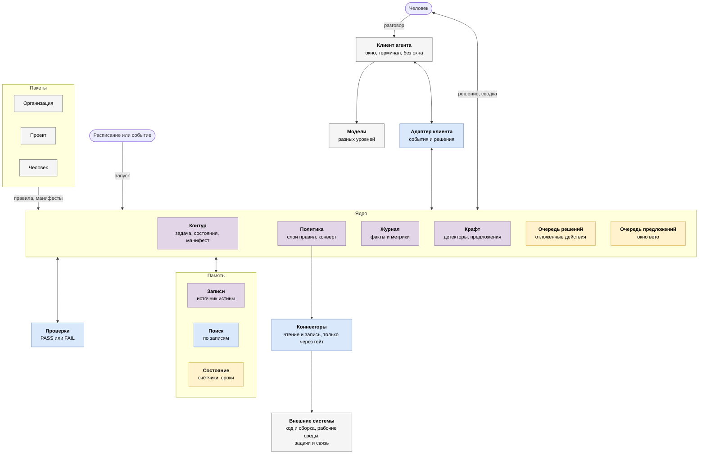

- Синее это контракты: их заполняют пакеты.
- Фиолетовое это ядро: оно одно для всех.
- Серое заменяемо: клиент, модели, системы, пакеты.

## 2. Общие правила

Правила, которые действуют во всей модели.

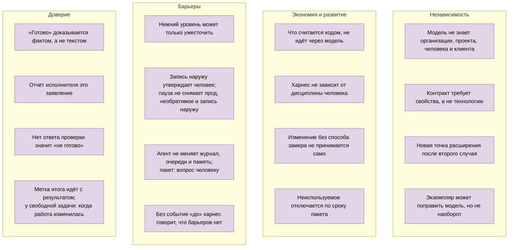

## 3. Состояния задачи

Контур: состояния задачи и переходы.

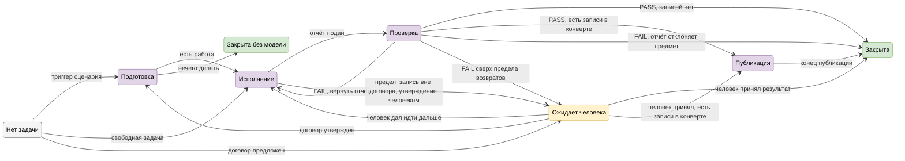

| Состояние | Пояснение |
|---|---|
| Подготовка | сбор и условие |
| Исполнение | агент действует |
| Проверка | фактами |
| Публикация | итог принят, конверт действует |
| Закрыта | с меткой итога |

- Задача сценария начинается с подготовки. Свободная задача начинается сразу с исполнения. Задача с договором начинается с ожидания человека.
- Остановка человеком и срок закрывают задачу из любого открытого состояния. Схема эти переходы не показывает.

**Правила контура**

1. Состояние хранит харнес. Агент не может сам перевести задачу в «Закрыта».
2. Каждый переход пишется в журнал. Исключение: вход в публикацию своей строки не имеет.
3. Предел возвратов задаёт манифест: от 0 до 5. После предела решает человек. Ответ FAIL, в котором каждая ошибка это значение `done.reject`, закрывает задачу сразу с меткой «отклонено» (`rejected`): возврата нет и предел не тратится.
4. Свободная задача идёт без манифеста: шаг «Проверка» пропускается, итог помечается «не проверено».
5. Сбой самого харнеса пишется в журнал и не даёт молчаливого пропуска: собственное чтение клиента проходит, остальное это вопрос человеку; клиент, который не различает чтение, спрашивает о любом действии.
6. У задачи может быть несколько исполнителей. Предел токенов задачи это `model.token_limit` манифеста, без него предел пакетов: пакет даёт верхнюю границу. Задача в исполнении сверх предела токенов ждёт человека. У свободной задачи ожидания нет: сверх `limits.free_tokens` пакета агент один раз получает слово харнеса. Подробности в разделе 8.
7. Задача с договором проходит те же состояния. Перед «Подготовкой» человек утверждает договор. Подробности в разделе 6.
8. У события есть источник. Агент сообщает «готово»; событие вопроса есть в автомате, клиенты его не посылают. Ответ проверки даёт только харнес. Утверждение даёт только человек.
9. Состояние задачи это один файл вне рабочего дерева. Запись в него идёт по одному: два процесса не меняют одну задачу сразу.
10. Сбой сбора закрывает задачу с меткой «не проверено». Предел времени и размера действует и на процессы, которые запустил скрипт.
11. Принятый результат задачи с записями в конверте переводит задачу в публикацию: метка итога уже известна, конверт ещё действует.
12. Публикацию завершает агент, человек (`reins stop`), срок, изменение работы, изменение скрипта проверки или конец срока годности ответа (`done.valid_minutes`). После этого конверт закрыт и задача закрыта.
13. Отчёт сценария с утверждением человеком идёт сразу в «Ожидает человека». Вопрос барьера о действии задачу не переводит: она остаётся в исполнении.
14. Срок задачи без действий: свободная задача 12 часов, сценарий и договор 24 часа, публикация 1 час.

## 4. Вид задачи

Как запрос становится видом задачи.

| Что пришло | Как узнаётся | Вид задачи | Кто решает |
|---|---|---|---|
| Расписание или событие | привязка в манифесте | сценарий | код |
| Команда с именем сценария | имя сценария | сценарий | агент или человек; по манифесту только человек |
| Вход известной формы | команда `reins match`: форма совпала с одним манифестом | сценарий | код по команде |
| Вход подходит нескольким сценариям | совпало больше одного манифеста | по выбору | человек или агент |
| Предложение договора (`reins propose`) | человек утверждает: `reins approve` | договор | человек |
| Запрос человека | событие клиента | свободная задача | код |
| Действие без запроса | факт действия | свободная задача | код |

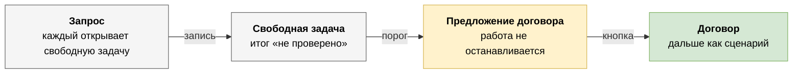

**Правила выбора**

1. Вид задачи определяют имя, форма входа и факты. Слова запроса вид не определяют.
2. Сценарий по имени открывает агент или человек. Манифест может оставить запуск только человеку: тогда команда запуска это вопрос человеку.
3. Ошибка в сторону свободной задачи видна: итог помечен «не проверено». Ошибка в сторону сценария дорога. Поэтому сценарий требует имени или формы входа.
4. Свободная задача растёт по фактам: порог действий записи задаёт пакет. Договор предлагается, но не навязывается.
5. Выбранный вид и причина выбора пишутся в журнал. Причина это код: имя сценария (также у расписания и события), форма входа, слово человека (также у договора, который предложил агент), факты.

## 5. Границы задачи

Где задача начинается и где кончается.

| Что произошло | Что происходит с задачей |
|---|---|
| Проверка дала PASS | нет записей в конверте: закрыта. Есть: публикация, конверт действует |
| Новый сценарий в той же сессии | старая задача приостановлена, её конверт молчит до возврата |
| Действие вне конверта | обычное решение политики, конверт не расширяется |
| Нет действий дольше срока (раздел 3, правило 14) | задача закрыта: итог «не проверено», у публикации её метка |
| Сессия закончилась | свободная задача закрыта; сценарий и договор можно продолжить |
| Человек остановил договор (`reins stop`) | работа остаётся свободной задачей |

- Конверт живёт не дольше задачи. Разрешение, выданное для одного сценария, не переходит на то, что человек попросил следом.
- В одной сессии может быть много задач. У одной задачи может быть много сессий. Задачу ведёт харнес, а не сессия клиента.
- Каждый запрос человека открывает свободную задачу. Она закрывается, когда агент остановился.
- Остановка не закрывает свободную задачу в четырёх случаях: ждёт ответ FAIL суда отчёта подчинённого; клиент без окна держит незаконченный сценарий; работа изменилась без проверки; работа изменилась без ревью. Тогда её закрывает следующий запрос.

## 6. Задача с договором

Задача с договором: «вот задача, сделай».

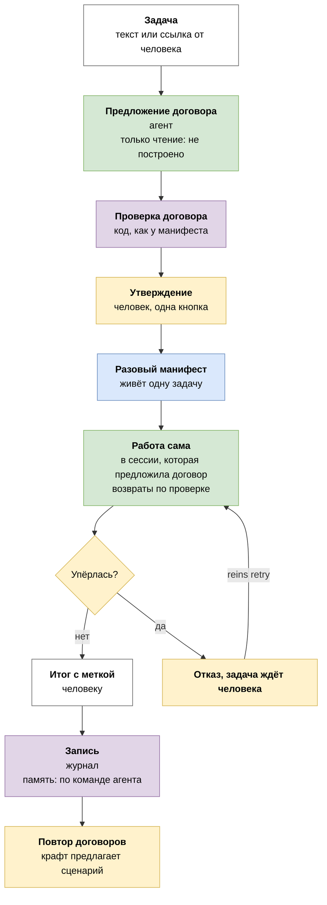

**Что входит в договор**

- цель одной фразой;
- границы: чтения и записи через коннекторы;
- проверка готовности: вид и имя проверки пакета;
- нужные действия записи;
- пределы: токены, возвраты.

**Три вида задач**

- сценарий: постоянный манифест из пакета;
- задача с договором: разовый манифест;
- свободная задача: без манифеста, итог «не проверено».

**Когда договор не помогает**

- у задачи нет проверяемого итога;
- договор без вида готовности не принимается;
- тогда это свободная задача;
- её итог помечен «не проверено».

**Правила**

1. Договор предлагает агент, утверждает человек. Без утверждения работа не начинается.
2. Договор проверяется тем же кодом, что манифест. Он не может просить больше, чем разрешают пакеты.
3. После утверждения договор не меняется. Если задаче нужно больше, она останавливается: человек даёт идти дальше или завершает её.
4. Предел токенов обязателен. Договор без него не принимается.
5. Запись наружу остаётся за человеком: по конверту с одним утверждением или через очередь.
6. Договор это манифест личного пакета с триггером-командой и без входов. Имя договора не совпадает с именем сценария.
7. Команда `reins approve` готовит задачу и делает её текущей задачей сессии, которая предложила договор. Клиент без окна для договора не запускается.
8. Команда `reins retry` на пределе токенов даёт задаче ещё один бюджет размером с предел.

## 7. Решение политики

Политика: как принимается решение по одному действию.

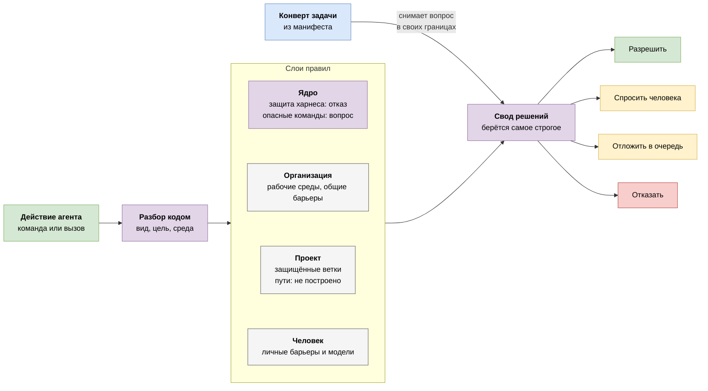

**Правила политики**

1. Слой может только ужесточить решение слоя выше. Строгость растёт так: разрешить, спросить, отложить, отказать.
2. Конверт задачи заменяет «спросить» на «разрешить» только для действий, названных в манифесте, сразу или после одного утверждения на задачу. Запрет слоя он не снимает.
3. Решение и его основание пишутся в журнал. Текст команды в журнал не пишется, если в нём может быть секрет.
4. Запись агента в состояние, память и конфигурацию харнеса это отказ. Правка пакета, кода харнеса и настроек клиента это вопрос человеку. Команда, которая только читает пакет или код харнеса, вопроса не получает. Команда чтения, которая называет состояние, память или конфигурацию харнеса, вопрос получает.
5. Отложенное действие утверждает только человек. Команда `reins` со словом решения человека от агента это отказ по правилу `protect.human-command`: утверждение, остановка, пауза, повтор, решение и вето памяти, принятие предложения крафта. Запуск клиента (`reins run`, `reins tick run`, `reins fire`) и открытие сценария, который манифест оставил человеку, это вопрос человеку.
6. Если клиент не сообщает о действии до его выполнения, харнес прямо говорит человеку, что барьеры не действуют.
7. Права подчинённого исполнителя не шире прав родителя. Он действует в конверте задачи родителя, своего конверта у него нет.
8. Решение по умолчанию это решение слоя ядра: чтение и изменение в рабочем дереве разрешены, запись требует вопроса. Вопроса требуют также чтение с секретами, инструмент без описания, чтение через коннектор сверх предела пакета, чтение задачи сценария через коннектор вне `permissions.read` её манифеста (правило `scenario.read-scope`) и вызов инструмента, когда число его сбоев подряд достигло предела пакета. Нижний слой его не ослабляет.
9. Запись в производственную или неизвестную среду утверждает человек на каждое действие. Конверт на неё не действует.
10. Исход слоя вне перечня считается отказом.
11. Пауза человека (до 8 часов) снимает вопросы. Она не снимает отказ и не снимает вопрос о записи в производственную или неизвестную среду, о необратимом действии и о записи наружу. Локальный `git merge` в защищённую ветку во время паузы проходит, `git push` в неё спрашивает. Вопросы защиты самого харнеса тоже остаются. Запись из конверта во время паузы проходит без счёта.

## 8. Несколько исполнителей

Несколько исполнителей в одной задаче.

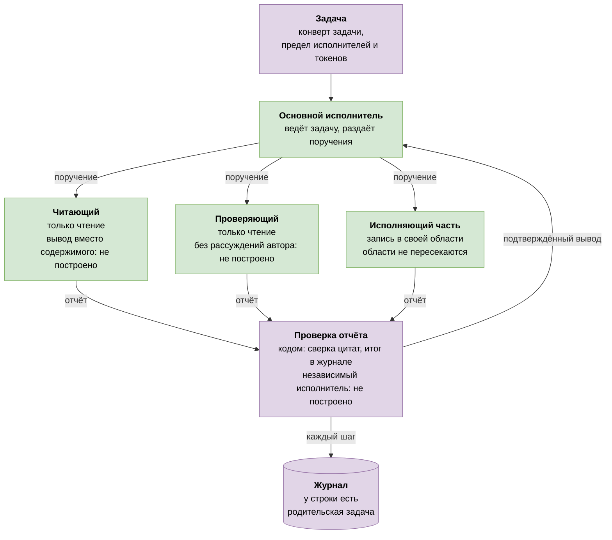

- Несколько исполнителей оправданы, когда нужна независимость, изоляция чтения или разные права.
- Несколько исполнителей не оправданы для последовательной работы с записью и для малых задач.

**Правила**

1. Права подчинённого не шире прав родителя. «Только чтение» и область записи действуют, когда манифест назвал права роли; без них роль работает в конверте родителя.
2. Отчёт подчинённого это заявление, а не факт.
3. У каждой строки журнала есть родительская задача.
4. В задаче с манифестом роли и число исполнителей задаёт манифест. Предел исполнителей пакета действует вне сценария. Предел токенов: раздел 3, правило 6. Подчинённый без отчёта дольше часа места не занимает.
5. Исполнители общаются только через основного: это порядок работы, барьера в коде на него нет.
6. Сбор данных делает скрипт, а не исполнитель.
7. Если пакеты дают уровням имена моделей, в задаче с манифестом (сценарий или договор) модель подчинённого не выше уровня задачи. Пустое имя модели и имя, которое пакеты не дали ни одному уровню, дают отказ. Запуск без поля модели не судится.
8. Отказ подчинённому это решение в журнале с правилом и ролью. Исключение: отказ без родительской задачи строки не имеет.

## 9. Описание действия

Что коннектор сообщает о каждом своём действии.

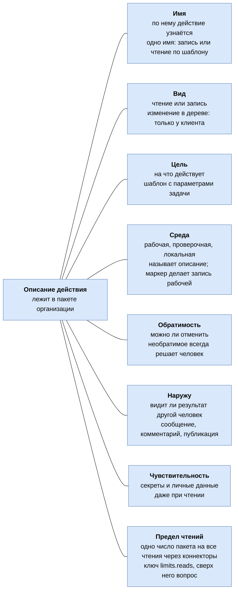

- Как коннектор устроен внутри, ядру неважно: это может быть инструмент клиента, команда или скрипт. Важно только описание действий.
- Описание лежит в пакете организации. Свои инструменты клиента описывает адаптер. По описанию политика принимает решение, не понимая смысла действия.
- Вызов инструмента без описания считается записью неизвестного вида.
- Описание называет также коннектор и поле `read_when`: по нему вызов узнаётся как чтение. Своего предела чтений у описания нет: предел один на пакет.
- Изменение в рабочем дереве разрешено по умолчанию: его покрывает отпечаток состояния работы.

## 10. Среды

Решение по умолчанию: вид действия и среда.

| Действие | Среда | Решение по умолчанию |
|---|---|---|
| Чтение | локальная или проверочная | разрешить |
| Чтение | рабочая | разрешить, факт в журнале; строка журнала несёт среду из описания, без неё `local` |
| Чтение чувствительного | любая | спросить человека |
| Запись обратимая | локальная или проверочная | спросить, конверт может разрешить |
| Запись наружу | любая | одно утверждение на задачу по конверту; пауза не действует |
| Запись | рабочая | человек на каждое действие; конверт и пауза не действуют |
| Запись необратимая | любая | человек на каждое действие; пауза не действует |

- Среду вызова инструмента называет описание действия. Маркер делает запись производственной: имя кластера, хоста или проекта во входе вызова. Среду команды оболочки определяет маркер.
- Маркеры задают пакет организации и конфигурация машины (ключ `markers`).
- Вход вызова больше 200 значений или глубже 4 уровней считается производственным.
- Если среду определить нельзя, она считается рабочей.
- Пакет может сделать любое из этих решений строже. Мягче сделать нельзя.

## 11. Структура манифеста

Структура: заголовок и восемь полей.

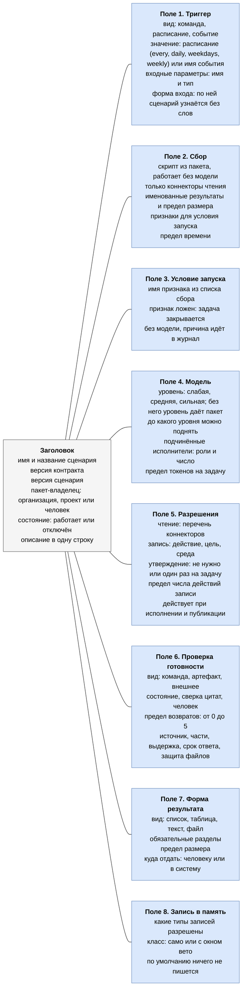

**Уточнения полей**

- Триггер: ключ `trigger.open` называет, кто открывает сценарий команды: `agent` или `human`. Типы входа: `string`, `number`, `id`, `url`. Расписание `every <n>`: от 1 до 9999, единицы `m`, `h`, `d`.
- Проверка готовности: `done.reject` называет значения находки, с которыми отчёт отклоняет свой предмет. `done.recheck` называет значения находки, которые требуют исправления. `done.changed` называет список изменённых файлов, в который должна попасть находка. `done.valid_minutes`: от 1 до 10080. `done.soak_minutes`: от 1 до 1440, только у вида «внешнее». `done.guards`: до 20 шаблонов файлов проверки.
- Форма результата: обязателен `max_items` или `max_bytes`. Предел числа находок применяет только сверка цитат. Предел байтов применяется к отчёту любого вида проверки, кроме сверки цитат: у неё предел ядра 1 МиБ.

**Правила формата**

1. Поля фиксированы. Манифест с неизвестным полем не подключается.
2. В манифесте нет условий, ветвлений и исполняемого кода. Условие запуска это имя признака, а не выражение.
3. Значения берутся из закрытых перечней или ссылаются на объекты пакета: скрипт, коннектор, проверку.
4. Манифест может запросить меньше, чем разрешает пакет, но не больше.
5. Файл манифеста это JSON. Комментариев и вычисляемых значений в нём нет.

## 12. Конверт разрешений

Поле «Разрешения»: конверт задачи.

**Что можно назвать в конверте**

| Часть | Значение |
|---|---|
| Чтение | перечень коннекторов чтения |
| Запись | действие, цель по шаблону, среда |
| Утверждение | не нужно или один раз на задачу |
| Предел | число действий записи |
| Срок | исполнение и публикация; конверт публикации молчит, когда задача не менялась час |
| Харнес | ключ `permissions.harness`: задача сценария для каталога харнеса снимает вопрос о правке `test/`, `docs/` и `src/`; код барьера спрашивает на каждую правку |

**Чего в конверте быть не может**

- Действие вне перечня действий записи пакета.
- Изменение правил, журнала или очереди.
- Цель «всё» без шаблона.

**Итог политики с конвертом**

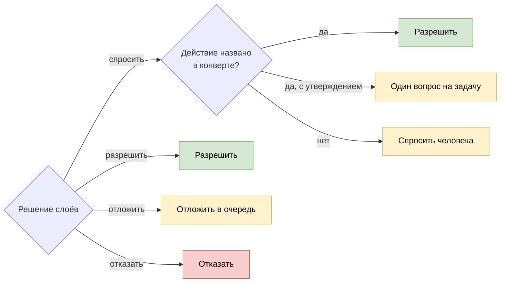

При решении слоёв «разрешить», «отложить» и «отказать» конверт на итог не влияет.

- Конверт делает одно: заменяет «спросить» на «разрешить» для названных действий, сразу или после одного утверждения на задачу. Он не снимает отказ и не обходит очередь.
- Необратимая запись спрашивает каждый раз. Запись, которую видит другой человек, требует одного утверждения. Сверх предела действия снова вопрос.
- Манифест с конвертом вне перечней пакета не подключается: это проверяет код при подключении. Запрет слоя правил действует при самом действии, а не при работе.
- Подчинённый исполнитель действует в конверте задачи родителя, своего у него нет.
- Запись всегда называет среду. Пакет без списка сред не допускает записи в конверте: неизвестная среда считается производственной.

## 13. Виды проверок

Пять видов проверок в деталях.

| Вид | Что запускается | Что считается PASS | Свидетельство | Метка итога |
|---|---|---|---|---|
| Команда | скрипт пакета `check/<имя>` | скрипт завершился с кодом 0 и напечатал JSON с `result: PASS` | ответ скрипта | проверен результат |
| Артефакт | скрипт пакета: поиск объекта | то же, что у вида «Команда» | ответ скрипта | проверен результат |
| Внешнее состояние | скрипт пакета: чтение через коннектор | то же, что у вида «Команда» | ответ скрипта | проверен результат |
| Сверка цитат | сравнение ссылок с источником | все ссылки найдены | список сверенного | проверена форма |
| Человек | вопрос с выбором | ответ «да» | кто и когда ответил | утверждено человеком |

- Скрипт пакета, который доказывает только форму результата, называет это в манифесте: метка тогда «проверена форма», а не «проверен результат».
- Человек может принять результат, который проверка не приняла сверх предела возвратов: метка «утверждено человеком».
- Пятая метка итога это «отклонено» (`rejected`): отчёт верен по форме и сам говорит, что его предмет не держится (значение из `done.reject`). Это ответ «нет», а не принятый результат.
- Отчёт сверки цитат несёт не больше 10 находок или меньше, по `output.max_items`: больше это FAIL. Сверка идёт не дольше 5 секунд.
- Ненулевой код выхода скрипта проверки это «нет ответа», а не FAIL.
- Проверка скриптом может состоять из частей: от 2 до 5 имён проверок пакета (`done.checks`). У сверки цитат и у вида «Человек» частей нет. Итог PASS только если все части дали PASS. При FAIL в ответе названа каждая часть, которая не прошла.
- Новый вид проверки это изменение контракта. Новая команда проверки это изменение пакета проекта.
- Вид «Человек» нужен там, где итог нельзя проверить кодом. Он честнее, чем слабая автоматическая проверка.

## 14. Привязка к состоянию

Привязка ответа к состоянию работы.

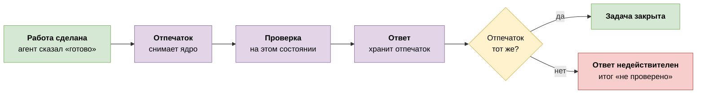

**Что входит в отпечаток**

- в репозитории: коммит, изменения и содержимое первых 500 новых файлов;
- вне репозитория: имена, размеры и время файлов, до 2000 имён; больше имён: отпечатка нет.

Версия проверки хранится рядом с отпечатком работы: это отпечаток файлов скрипта `check/<имя>`. У сверки цитат и у вида «Человек» версии нет.

**Когда ответ недействителен**

- работа изменилась после проверки;
- скрипт проверки изменился после ответа;
- прошёл срок годности ответа.

**Выдержка**

- внешнее состояние меняется со временем;
- проверка повторяется через срок;
- PASS засчитан после второго ответа.

Без привязки зелёный ответ можно получить на одном состоянии и закрыть задачу на другом. Привязка делает такой обход невозможным. Зелёный ответ скрипта без отпечатка работы это не ответ. Исключение называет манифест: результат не лежит в каталоге (запись памяти, состояние системы).

Выдержка нужна для операций: «алерты не горят» сразу после выкладки ещё ничего не значит. Срок выдержки задаёт манифест.

## 15. Строка журнала

Строка журнала: общие поля каждого события.

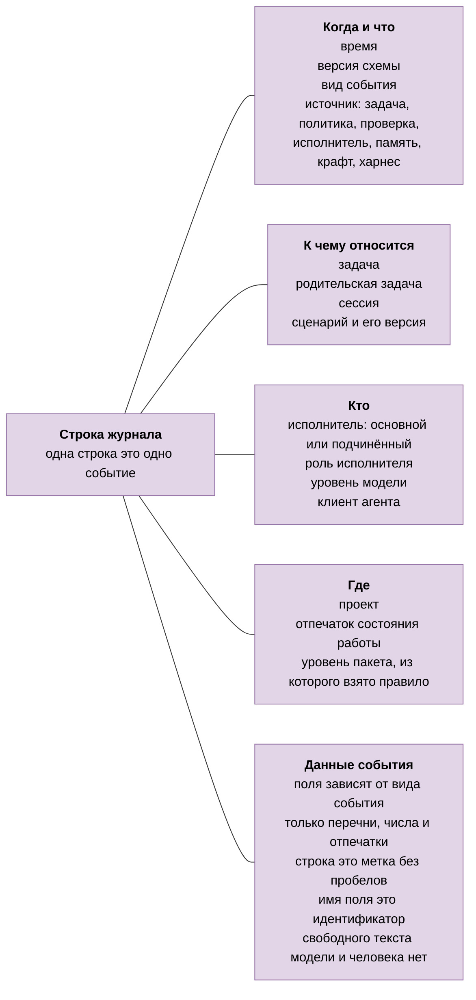

**Правила строки**

1. Одна строка это одно событие. Строки только добавляются, прошлое не правится.
2. У строки есть версия схемы. Читатель пропускает поля, которых не знает.
3. Смысл поля не меняется. Новый смысл это новый вид события, а не новое значение старого поля.
4. Пишет только ядро. Агент не пишет в журнал и не меняет его.
5. Журнал хранит факты для кода. Тексты запросов, команд и отчётов в него не попадают: только вид, размер и отпечаток.

## 16. Виды событий

Виды событий по источникам.

| Группа | Виды событий |
|---|---|
| Контур | задача открыта · вид задачи определён, с причиной · договор предложен · договор утверждён · подготовка завершена · задача пропущена: работы нет · исполнение начато · отчёт подан · задача возвращена · ожидание человека · решение человека, в том числе «нет» · задача закрыта: метка итога, была ли правка · итог оспорен человеком |
| Политика | решение по действию · основание решения: слой и правило · конверт открыт · конверт закрыт · действие отложено · отложенное действие решено · попытка изменить защищённое |
| Проверка | проверка запущена · ответ проверки: PASS или FAIL · проверка не ответила · ответ недействителен: работа изменилась, проверка изменилась или срок ответа прошёл · превышен предел возвратов · отказ проверки оспорен человеком |
| Исполнители и стоимость | исполнитель запущен · отчёт исполнителя получен · отчёт подтверждён или отклонён · уровень модели поднят · расход: токены по видам, модель, время, вызовы · инструмент дал ошибку · вывод инструмента: имя и размер |
| Память и крафт | память прочитана: число записей и способ, размер у чтения в контекст · поиск ничего не нашёл · перепись памяти · запись использована · запись добавлена, изменена или удалена · паттерн найден · предложение создано · предложение применено или отклонено · замер эффекта |
| Харнес | сбой харнеса · превышено время шага · форма события клиента изменилась · уровень клиента определён · барьеры не действуют · итог слияния пакетов · пакет изменён · манифест отклонён при подключении · текст дан агенту: место и размер · проверочные команды барьера: пропуски и шум |

- Перечень видов закрыт: событие неизвестного вида в журнал не пишется. Новый вид добавляется в перечень кода. Версия строки растёт, когда меняется форма строки.
- Группа «Харнес» это журнал о самом харнесе: по ней видно, можно ли доверять остальным строкам.
- Источников семь: задача (группа «Контур»), политика, проверка, исполнитель, память, крафт, харнес. Источник это начало имени вида события.

## 17. Типы записей

Типы записей памяти и общие поля.

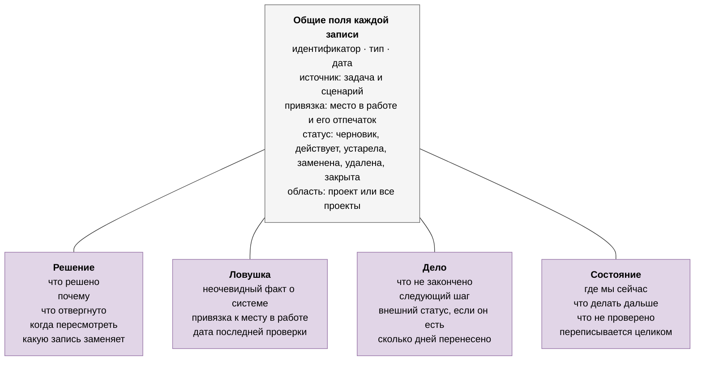

**Правила записей**

1. Решение без причины не принимается: через месяц оно бесполезно.
2. В память не пишут то, что видно из самой работы или её истории изменений.
3. Предпочтения человека, например язык и тон, это личный пакет, а не память.
4. Запись становится общей по слову человека: команда `share`.

## 18. Жизненный цикл записи

Жизненный цикл записи памяти.

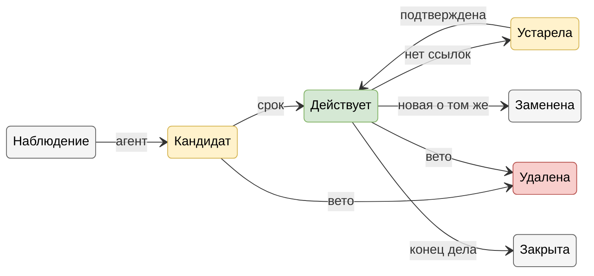

| Состояние | Пояснение |
|---|---|
| Наблюдение | Запись агента в сценарии. Слово человека и принятое предложение крафта действуют сразу, без черновика |
| Кандидат | Ждёт в очереди. Вето одной кнопкой |
| Действует | Попадает во вход задач. Ссылки считаются |
| Устарела | Нет ссылок за срок или место в работе изменилось |
| Удалена | вето человека |
| Закрыта | дело закончено |

- Переходы делает код. Человек нужен в трёх местах: вето на запись, решение с причиной, возврат удалённой или устаревшей записи.
- Привязка к месту в работе хранит отпечаток. Если место изменилось, запись уходит в «Устарела», а не продолжает влиять на ответы.
- Удаление это вето человека: смена статуса из любого состояния, кроме «Заменена» и «Закрыта». Содержимое остаётся. Человек может вернуть запись в «Действует», пока не прошёл срок хранения удалённых записей из пакета: после него файл стирается.
- Новое состояние действует сразу и заменяет прежнее: окна вето у него нет.
- Дело получает шаг и конец командой: закрытое дело уходит в «Закрыта». Дело кончается также шагом с внешним статусом из списка `memory.case_end` пакета. Закрыть можно и дело-черновик.
- Решение заменяет и устаревшее решение: замена идёт из любого состояния, кроме «Удалена».

## 19. Наложение пакетов

Как настройки разных уровней складываются.

| Вид настройки | Правило слияния | Кто задаёт |
|---|---|---|
| Барьеры | берётся самое строгое | ядро, организация, проект, человек |
| Пределы | берётся наименьший | организация, затем проект и человек |
| Разрешения | только внутри разрешённого уровнем выше | проект и человек |
| Сценарии | объединяются, имена не повторяются | все три уровня |
| Уровень модели | человек выбирает из разрешённых | организация ограничивает, человек выбирает |
| Сроки вето | не короче минимума уровня выше | организация задаёт минимум |
| Язык и тон | тексты всех уровней складываются | все уровни |

- Одно правило на всё: нижний уровень может сузить барьер, но не расширить.
- Настройки без барьера нижний уровень заменяет: имя модели уровня, уровень по умолчанию, числа крафта, пороги мер.
- Тексты `pack.md` всех уровней складываются. Сроки хранения берутся наибольшие.
- Итог слияния считается кодом при старте. В журнал идут его числа и отпечаток, когда отпечаток изменился. Команда `reins packs` показывает, какой уровень дал списки и пределы.
- Коннекторы, роли исполнителей и список известных сред задаёт организация. Нижний уровень может убрать коннектор или пометить ещё одну среду производственной.
- Список, которого не дал ни один пакет, означает «ничего», а не «без проверки». Исключение: типы записей памяти. Без списка манифест может назвать любой тип из перечня ядра.
- Пакет с ошибкой не подключается целиком, а с ним и уровни ниже. Уровни выше продолжают работать. Пакет с ошибкой назван в начале сессии и в списке сценариев.
- Манифесты проверяются по итогу слияния всех уровней: предел человека действует на сценарий проекта.

## 20. События клиента

О чём клиент сообщает ядру.

| Событие клиента | Что делает ядро | Что будет без события |
|---|---|---|
| Начало сессии | готовит вход: состояние, дела, память | агент начинает без контекста |
| Запрос человека | открывает свободную задачу | задача откроется на первом действии |
| Перед действием | решает: разрешить, спросить, отложить, отказать | барьеры не действуют |
| После действия | пишет ответ человека и сбой инструмента | нет фактов для проверки и крафта |
| Запуск и отчёт подчинённого | связывает с задачей, проверяет отчёт; его вопросы закрывает клиент с номером исполнителя | подчинённые вне учёта |
| Конец хода | закрывает задачу, вопрос без ответа это «нет» | свободная задача ждёт срока |
| Перед сжатием контекста | отмечает задачу сессии | после сжатия агент не знает о задаче |
| Конец сессии | пишет передачу со счётчиками, закрывает задачу | следующая сессия не знает о прошлой |

- Событие «перед действием» единственное, без которого харнес не может быть барьером. Остальные события ухудшают работу постепенно.
- Действие, которое началось после вопроса, это «да» человека, даже если оно упало. Прерванное действие не считается ни «да», ни «нет».

## 21. Решения ядра

Что ядро возвращает клиенту.

| Решение ядра | Что должен уметь клиент | Если клиент не умеет |
|---|---|---|
| Разрешить | выполнить действие | не применимо |
| Отказать с причиной | не выполнять и показать причину агенту | харнес не может быть барьером |
| Спросить человека | показать вопрос с выбором и вернуть ответ | вопрос идёт в очередь, человек отвечает командой |
| Отложить | не выполнять и сообщить, что действие в очереди | действие считается отказом |
| Добавить после действия | передать агенту строку харнеса: источник вывода, предложение договора, ответ суда отчёта подчинённого, расход свободной задачи выше предела | агент не узнаёт источник вывода |
| Вернуть отчёт | не завершать ход, до двух раз; в окне ход также возвращается, когда работа изменилась без проверки или без ревью | проверка только записывает итог |

Ядро всегда возвращает решение в одном формате. Перевод в форму конкретного клиента делает адаптер.

Ответ на запрос человека несёт слово о длинной сессии, когда счёт запросов достиг предела пакета `limits.session_requests`. Харнес сессию не закрывает.

## 22. Детекторы

Детекторы крафта: что считают и что предлагают.

| Детектор | Что считает | Порог | Что предлагает |
|---|---|---|---|
| Повтор цепочки действий | одна последовательность в разных задачах | 3 задачи | скрипт сбора или сценарий |
| Повтор договоров | похожие разовые манифесты | 3 договора | постоянный сценарий |
| Повтор одобрений | один вид действия, ответ всегда «да» | задаёт пакет | действие в конверт сценария |
| Повтор ошибки инструмента | сбои одного инструмента | 5 раз, задаёт пакет | ловушка в память |
| Модель сильнее нужной | нет возвратов и подъёмов на сценарии | задаёт пакет | понизить уровень модели |
| Модель слабее нужной | частые подъёмы уровня | число задач: пакет; доля 0,5: ядро | повысить уровень модели |
| Частые возвраты | доля FAIL у сценария | число проверок: пакет; доля 0,5: ядро | править сценарий, решает человек |
| Неиспользуемый сценарий | нет запусков | срок `idle_days` пакета | отключает ядро, не крафт; человек включает |
| Запись без ссылок | нет ссылок на запись памяти | 30 дней или срок пакета | перевести в «устарела» |
| Мёртвая запись памяти | выдачи записи агенту без ссылки в отчёте | 5 выдач | перевести в «устарела» |
| Мера выше порога | дни, когда мера харнеса выше порога пакета | 2 дня из 7 | причину ищет человек |

- Порог каждого детектора задан в ядре и меняется пакетом: вопросы одного правила 5, одобрения 5, цепочки 3, договоры 3, сбои инструмента 5, задачи без возвратов 10, подъёмы 3, проверки 4. Доли 0,5 и «2 дня из 7» пакет не меняет.
- Детектор это функция над строками журнала. Он не читает тексты и не вызывает модель.
- Новый детектор добавляется в ядро вместе с видом предложения и способом замера. У «повтора цепочки» замера нет.
- «Повтор одобрений» предлагает сузить вопрос до конкретного сценария. Он никогда не предлагает снять барьер целиком.
- Ещё два детектора: повтор вопроса одного правила; проверка, которая дала PASS и FAIL на одну работу и один отчёт.
- Готовая правка есть у трёх предложений: манифест из договора, запись «устарела», ловушка. Остальные правки человек делает сам.
- Число вопросов и ответов по правилу детекторы берут из кода метрик: сводка, показ и крафт не дают разных чисел.
- Ссылка в ответе свободной задачи считается отдельно, но тоже продлевает срок записи и снимает признак «мёртвая».
- Правила `protect.*` и `adapter.*` детекторы вопросов не считают. На одно правило идёт одно предложение.
- «Мёртвая запись» не судит решения. «Мера выше порога» читает пороги раздела `targets` пакета.
- Сценарий с записью наружу и без неё код не различает: оба решает человек.

## 23. Виды предложений

Виды предложений крафта и класс автономии каждого.

| Предложение | Что меняет | Класс |
|---|---|---|
| Перевести запись в «устарела» | память | с окном вето, срок задаёт пакет |
| Новая ловушка | память | только человек |
| Откат принятого предложения | то, что изменило предложение | только человек |
| Понизить или повысить уровень модели | манифест, в пределах пакета | только человек |
| Новый сценарий без записи наружу | манифест в пакете | только человек |
| Новый сценарий с записью наружу | манифест и конверт | только человек |
| Действие в конверт сценария | конверт | только человек |
| Новый скрипт сбора или проверки | исполняемый код в пакете | только человек |

- Класс задан видом изменения, а не уверенностью крафта. Всё, что расширяет запись, добавляет исполняемый код или трогает барьеры, утверждает человек.
- Ещё четыре предложения без готовой правки решает только человек: править сценарий при частых FAIL, править нестабильную проверку, описать правило с повтором вопроса, найти причину меры выше порога.
- Без срока пакета (`craft.auto_days`) и после отказа человека предложение «перевести запись в „устарела“» решает только человек.
- Крафт не предлагает менять ядро, контракты и слои правил. Таких видов предложений нет.

## 24. Классы автономии

Где нужен человек, а где нет.

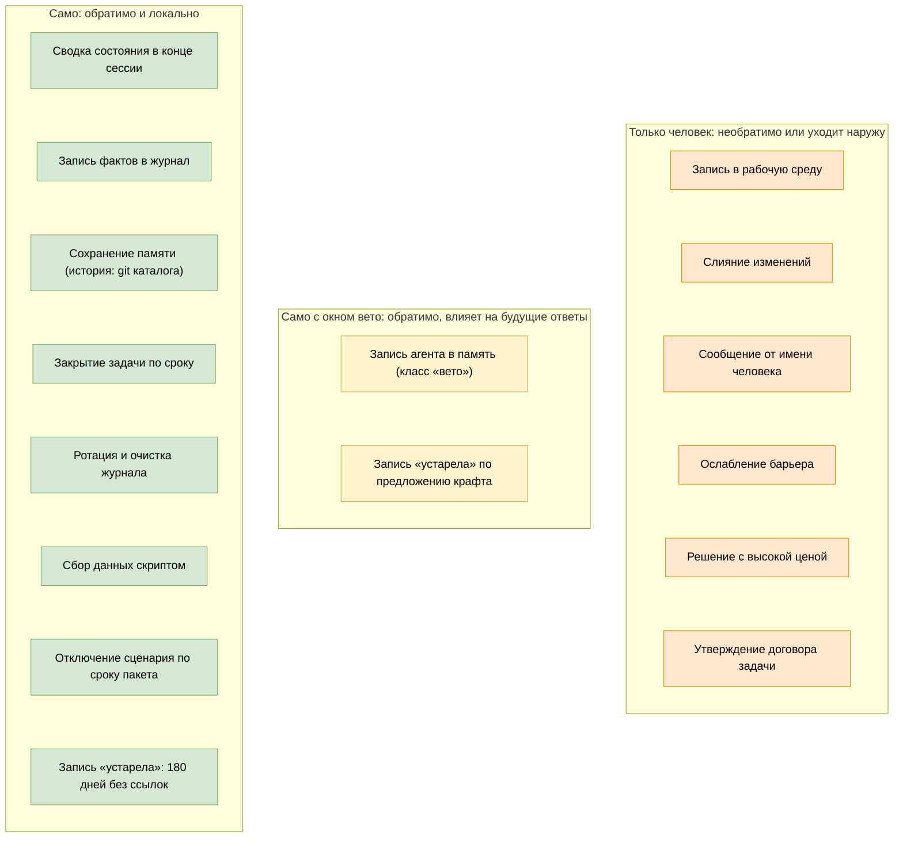

- Срок вето задаёт пакет. Класс действия задан в ядре: ключа пакета для класса нет.
- В классе «Только человек» от человека нужна одна команда. Решение в памяти требует текст и причину. Харнес не должен зависеть от дисциплины человека.
- Пауза человека не снимает вопрос о записи в рабочую среду, о необратимом действии и о записи наружу.
- Локальный `git merge` в защищённую ветку во время паузы проходит: `git push` после него спрашивает (решение владельца 16.11.2026).

---

# Часть 2. Пояснения

Часть 2 поясняет норму: окружение, состав ядра и детали каждого контракта. Норма это часть 1.

## П1. Модель: окружение, уровни, способы работы

### Контекст

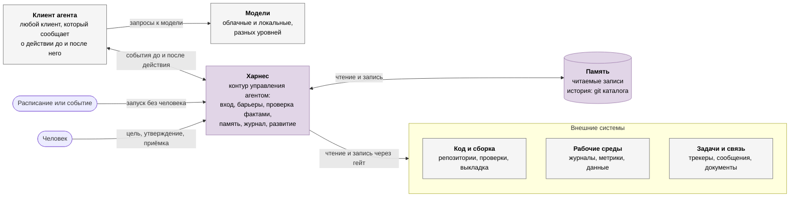

- Агент достаёт до систем только через харнес.
- Человек общается только с харнесом.
- Клиент, модель и системы заменяемы.

### Три уровня

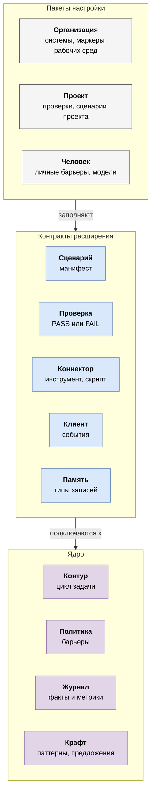

- Пакеты меняются часто. Их пишет организация, проект, человек.
- Контракты меняются редко. Каждый контракт это обязательство совместимости.
- Ядро не знает об организации, проекте и человеке. Оно остаётся маленьким.
- Правило политики: нижний уровень может только ужесточать барьеры. Проект не снимает защиту, заданную организацией.
- Агент правит пакет только с ответом «да» человека на каждую правку.

### Варианты использования

- Актёры: человек, расписание или событие, системы.
- Человек: выполнить сценарий, выполнить задачу по договору, выполнить свободную задачу, утвердить действие, принять результат, отметить неверный ответ, отклонить предложение, добавить сценарий или пакет.
- Расписание или событие: выполнить сценарий.
- Сценарий включает три общих варианта: запросить данные, проверить фактами, пройти гейт. Эти варианты работают с системами.
- Задача по договору исполняется как сценарий с разовым манифестом.
- Свободная задача идёт без манифеста: харнес даёт ей память и гейт, но не проверку готовности.

### Донастройка

1. Ядро и адаптер клиента. Ставится один раз. Не содержит ничего об организации, проекте и человеке.
2. Пакет организации. Коннекторы к системам, маркеры рабочих сред, общие барьеры.
3. Пакет проекта. Команда проверки проекта, сценарии, общие для команды.
4. Личный пакет. Правила работы и частые задачи, барьеры только строже уровней выше, модели по умолчанию.
5. Первый манифест. Под самую частую работу. На нём проверяется контракт.
6. Дальше по данным. Крафт показывает повторы. Новый сценарий после третьего повтора. Неиспользуемое отключается по сроку пакета.

Проверка независимости: каждый элемент модели должен оставаться верным для другого человека в другой организации с другим клиентом. Всё, что не проходит эту проверку, живёт в пакете, а не в модели.

### Способы работы

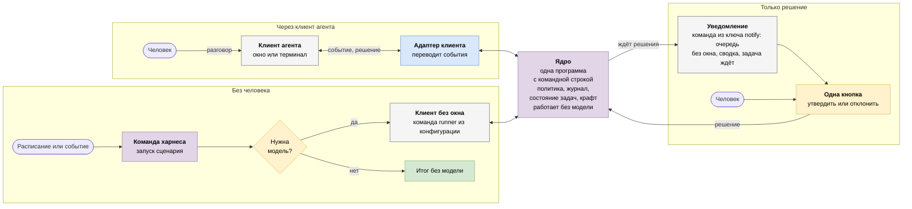

- Команды самого харнеса, без модели: показать состояние и очередь; утвердить или отклонить отложенное действие; запустить сценарий; показать итог задачи; найти запись памяти; показать метрики.
- Требования к клиенту: сообщать о действии до его выполнения; уметь задать вопрос с выбором; запускаться без окна с ограниченным набором инструментов.
- Своего экрана у харнеса нет. Он нужен только тогда, когда очередь решений становится большой.

## П2. Сквозной путь одной задачи

```mermaid
flowchart LR
  classDef core fill:#e1d5e7,stroke:#9673a6,color:#000

  s1["Триггер"]:::core --> s2["Вид задачи"]:::core --> s3["Сбор и условие"]:::core --> s4["Правила и конверт"]:::core --> s5["Исполнение"]:::core
  s5 --> s6["Исполнители"]:::core --> s7["Проверка готовности"]:::core --> s8["Решение человека"]:::core --> s9["Запись"]:::core --> s10["Развитие"]:::core
```

| Шаг | Что происходит | Где описано |
|---|---|---|
| 1. Триггер | команда, расписание, событие | разделы 20, 11 |
| 2. Вид задачи | сценарий, договор или свободная | разделы 4, 5, 6 |
| 3. Сбор и условие | скрипт без модели | П4 |
| 4. Правила и конверт | слияние пакетов | разделы 19, 12 |
| 5. Исполнение | каждое действие через политику | раздел 7, П6 |
| 6. Исполнители | поручения и проверка отчётов | раздел 8 |
| 7. Проверка готовности | возврат до предела, метка итога | П4, раздел 14 |
| 8. Решение человека | одна кнопка или очередь | П1, раздел 21 |
| 9. Запись | журнал, память, состояние | раздел 16, П8 |
| 10. Развитие | детекторы, предложения, сводка | П11 |

Модель участвует в шагах 5 и 6. Остальное делает код, включая текст предложений шага 10.

## П3. Состав ядра

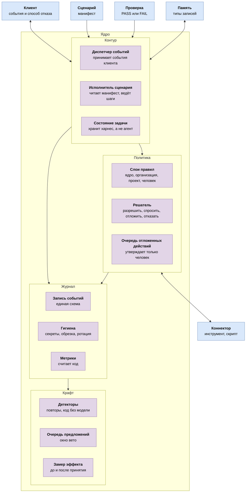

- Синие блоки это контракты. Ядро не знает, чем они заполнены.
- Каждое действие агента идёт из контура в политику. Каждое решение идёт в журнал.

## П4. Манифест: исполнение, проверка готовности, пример, цикл

### Как ядро исполняет поля манифеста

| Состояние задачи | Поля манифеста | Что делает ядро |
|---|---|---|
| Нет задачи | Триггер | Создаёт задачу. Проверяет входные параметры |
| Подготовка | Сбор, Условие запуска | Запускает скрипт сбора. Работы нет: задача пропущена без модели |
| Исполнение | Модель, Разрешения | Называет уровень модели; без окна ставит модель. Открывает конверт для политики |
| Проверка | Форма результата, Проверка готовности | Проверяет форму текста: разделы у `text`. Форму `list` читает сверка цитат. Запускает проверку сам. FAIL: возврат до предела |
| Публикация | Запись в память | Итог принят, конверт действует. Записи пишутся, пока задача открыта |
| Закрыта | нет | Пишет итог в журнал |

- Ядро читает манифест один раз при создании задачи и дальше работает с этой копией. Изменение файла манифеста во время задачи на неё не влияет.
- Каждый шаг исполняет код ядра. Модель участвует только в состоянии «Исполнение».
- Свободная задача не имеет манифеста: нет сбора, нет конверта, нет проверки. Итог помечается «не проверено».

### Проверка готовности и метка итога

| Вид проверки | Что проверяет | Метка итога |
|---|---|---|
| Команда | код возврата и вывод; пример: тесты проекта | проверен результат |
| Артефакт | объект существует и относится к этой работе | проверен результат |
| Внешнее состояние | чтение через коннектор; пример: состояние среды | проверен результат |
| Сверка цитат | каждое утверждение подтверждено источником | проверена форма |
| Человек | явное утверждение одной кнопкой | утверждено человеком |

Метка «не проверено»: нет манифеста, сбой сбора, остановка, срок или работа изменилась. Метка «отклонено» (`rejected`): раздел 13.

**Правила проверки**

1. Проверку запускает ядро, а не агент. Агент не может изменить проверку и её ответ.
2. Ответ привязан к состоянию работы. Если работа изменилась после проверки, ответ недействителен.
3. Нет ответа значит «не готово». Молчание проверки никогда не считается успехом.
4. Сверка цитат подтверждает, что утверждение опирается на источник. Она не подтверждает, что утверждение верно. Поэтому метка «проверена форма».
5. Метка итога всегда показывается человеку вместе с результатом.
6. Сверку цитат ядро запускает само по тексту отчёта. Источник называет манифест: это результат шага сбора, а не путь от агента.
7. Находка без файла и строки, без цитаты или с цитатой не из источника это ответ «не готово». Исключения называет манифест: цитата из названного текста сбора и значение поля, которое идёт без цитаты. Нет источника: нет ответа.
8. Отчёт для сверки это данные: список находок. Ядро читает файл, строку и цитату. Остальные поля находки и их значения называет манифест.
9. Скрипт проверки, который доказывает только форму результата (запись сделана, файл есть), называет это в манифесте: метка тогда «проверена форма». Поднять метку манифест не может.

### Пример манифеста: ревью изменения

```json
{
  "manifest": 1,
  "name": "change-review",
  "title": "Ревью изменения",
  "package": "project",
  "trigger": {
    "kind": "command",
    "inputs": [{"name": "change_id", "type": "id"}]
  },
  "collect": {
    "script": "collect/change",
    "outputs": ["diff", "task", "discussion", "worktree"],
    "flags": ["has_new_commits"]
  },
  "run_if": "has_new_commits",
  "model": {
    "level": "medium",
    "raise_to": "strong",
    "executors": [{"role": "reviewer", "count": 1}]
  },
  "permissions": {
    "read": ["code-host", "tracker"],
    "write": [{
      "action": "comment",
      "target": "change/{change_id}",
      "env": "work",
      "limit": 20,
      "confirm": "once"
    }]
  },
  "done": {"kind": "citations", "retries": 2, "source": "worktree"},
  "output": {"format": "list", "max_items": 10, "fields": {"severity": ["high", "low"]}},
  "memory": {"write": ["pitfall"], "class": "veto"}
}
```

| Поле | Что значит в примере |
|---|---|
| Триггер | Сценарий запускается командой с одним параметром: номер изменения |
| Сбор | Скрипт из пакета проекта читает изменение, задачу и обсуждение. Модель в сборе не участвует |
| Условие запуска | Скрипт вернул признак «есть новые коммиты». Если их нет, задача закрывается без модели |
| Модель | Средний уровень. Подъём до сильного один раз за задачу командой `raise`. Один независимый проверяющий |
| Разрешения | Читать хостинг кода и трекер. Писать только комментарии в это изменение, до двадцати, после одного утверждения |
| Проверка готовности | У каждой находки есть цитата из рабочего дерева. Метка итога: «проверена форма». Два возврата |
| Форма результата | Список находок, не больше десяти |
| Запись в память | Разрешён один тип записи. Запись идёт через окно вето |

Имена коннекторов и скриптов это ссылки на объекты пакета. В манифесте нет адресов, названий систем и секретов. Этот же манифест работает в другой организации, если её пакет даёт коннекторы с теми же ролями.

### Что в манифест не кладут

| Хочется написать в манифест | Правильное место |
|---|---|
| Условие или ветвление | Скрипт сбора: он возвращает признак |
| Способ решения задачи | Модель, по описанию сценария в пакете |
| Название системы или адрес | Пакет организации, коннектор |
| Команда проверки проекта | Пакет проекта, контракт проверки |
| Личное разрешение | Личный пакет |
| Исполняемый код | Скрипт сбора или проверки отдельным файлом |
| Секрет | Нигде в харнесе: хранилище секретов системы |

Признак разросшегося манифеста: в нём появляется слово «если». Тогда сценарий делят на два или переносят условие в скрипт сбора. Манифест длиннее одного экрана почти всегда содержит то, чему место в пакете.

### Жизненный цикл манифеста

```mermaid
stateDiagram-v2
  direction LR
  classDef core fill:#e1d5e7,stroke:#9673a6,color:#000
  classDef contract fill:#dae8fc,stroke:#6c8ebf,color:#000
  classDef ext fill:#f5f5f5,stroke:#666666,color:#000
  classDef ok fill:#d5e8d4,stroke:#82b366,color:#000
  classDef part fill:#fff2cc,stroke:#d6b656,color:#000

  state "Человек пишет" as human
  state "Крафт предлагает" as craft
  state "Черновик" as draft
  state "Проверен" as checked
  state "Подключён" as attached
  state "Работает" as active
  state "Отключён" as off
  state "Удалён человеком" as removed

  human --> draft
  craft --> draft
  draft --> checked
  checked --> attached
  attached --> active
  active --> off
  off --> active: включён обратно
  off --> removed

  class draft,removed ext
  class checked core
  class attached contract
  class active ok
  class off,craft part
```

| Состояние | Пояснение |
|---|---|
| Черновик | Файл в пакете |
| Проверен | Код проверяет поля, перечни и конверт |
| Подключён | Виден как команда или расписание |
| Работает | Считаются запуски, доля PASS, возвраты |
| Отключён | Не вызывался долго или вето человека |
| Удалён человеком | Коммитом пакета |

- Манифест проверяется кодом до подключения: неизвестные поля, значения вне перечней и недопустимый конверт дают отказ.
- Сценарий команды, который долго не вызывался, отключается сам, когда пакет задал срок. Отключение обратимо одной командой.
- Низкая доля PASS это сигнал править сценарий: крафт кладёт предложение в очередь. Детектор по частоте возвратов не построен.
- Манифест от крафта подключает только человек: сам по сроку он не подключается.
- Разовый манифест задачи с договором проходит ту же проверку. Он живёт одну задачу и в пакет не попадает.
- Без пакета код проверяет только структуру: так проверяют черновик. Подключение всегда идёт с пакетом.

## П5. Проверка: запуск, права агента, сбои

Путь проверки: вход (отпечаток состояния работы) → запуск (ядро, с пределом времени) → ответ (PASS, FAIL или нет ответа) → свидетельство (что проверено и когда) → журнал (ответ с отпечатком).

**Что получает проверка**

- отчёт и собранные данные;
- параметры задачи;
- отпечаток работы снимает ядро: до и после;
- запись наружу закрыта в песочнице (ключ конфига).

**Что она возвращает**

- PASS или FAIL; у FAIL конец текста ошибок скрипта;
- без ответа: причина, код выхода, конец текста ошибок;
- отпечаток работы, которая проверена;
- у сверки цитат: ошибки по находкам.

**Когда она запускается**

- в конце хода, когда агент сказал «готово»;
- до отчёта: число запусков задаёт пакет;
- повторно после срока выдержки;
- никогда не запускается самим агентом.

Проверка это команда из пакета проекта или встроенный вид проверки. Ядро запускает её само и само читает ответ. Агент может запустить проверку до отчёта, если пакет дал число таких запусков: ответ ничего не принимает и возврат не тратит. Ответ без свидетельства не принимается.

| Агент может | Агент не может |
|---|---|
| Запустить проверку до отчёта, если пакет дал число запусков | Запустить проверку сам и принести её ответ |
| Видеть ответ и свидетельство | Объявить PASS текстом отчёта |
| Исправлять работу после FAIL | Изменить команду проверки или её настройки |
| Сказать, что проверка неверна, и передать это человеку | Править тесты после FAIL без вопроса человеку |
| | Удалить или переписать ответ проверки |

- После красного ответа файлы проверки, которые назвал манифест, переходят в защищённые: правка тестов и настроек идёт через вопрос человеку.
- Спор с проверкой разрешён: неверная проверка хуже отсутствующей. Решает его человек, а не агент.

| Что случилось | Что делает ядро |
|---|---|
| Проверка не ответила за предел времени | итог «не готово» с причиной и пределом, событие «проверка не ответила»; предел задаёт конфиг машины |
| Проверка упала при запуске | нет ответа с причиной: код выхода и конец текста ошибок; возврат агенту, после предела вопрос человеку |
| Ответ без свидетельства | считается отсутствием ответа |
| Ответ то PASS, то FAIL на одном состоянии | оба ответа в журнале, число в сводке, предложение крафта |
| Проверки для этой работы нет | метка «не проверено», а не PASS |
| Проверка слишком дорогая | число запусков до отчёта задаёт пакет, число возвратов манифест |

Ни один сбой не превращается в PASS. Молчание, ошибка и отсутствие проверки дают «не готово» или «не проверено».

## П6. Коннектор: сопоставление, чтение, составные действия

### Как действие агента сопоставляется с описанием

```mermaid
flowchart LR
  classDef core fill:#e1d5e7,stroke:#9673a6,color:#000
  classDef contract fill:#dae8fc,stroke:#6c8ebf,color:#000
  classDef ok fill:#d5e8d4,stroke:#82b366,color:#000
  classDef part fill:#fff2cc,stroke:#d6b656,color:#000
  classDef stop fill:#f8cecc,stroke:#b85450,color:#000

  a["<b>Действие агента</b><br/>вызов или команда"]:::ok
  b["<b>Разбор кодом</b><br/>имя, параметры"]:::core
  d{"Есть<br/>описание?"}:::part
  y["<b>Вид, цель, среда</b><br/>из описания"]:::contract
  p["<b>Политика</b><br/>решение"]:::core
  u["<b>Неизвестный вызов</b><br/>инструмента: это запись"]:::stop

  a --> b --> d
  d -->|да| y --> p
  d -->|нет| u
  u -->|спросить человека| p
```

| Что сопоставляется | Как |
|---|---|
| Вызов инструмента | описание называет действие из списка пакета; поля входа дают цель; среду называет описание; поле входа совпало с шаблоном пакета: чтение |
| Команда оболочки | разбор на части кодом, часть за частью; опасные классы команд знает ядро; команда вне этих классов разрешена |
| Скрипт сбора или проверки | объявлен в пакете заранее; только чтение; в песочнице запись из скрипта это отказ; получает путь конфигурации харнеса |

- Сопоставление делает код по имени и параметрам. Модель в нём не участвует и не может переименовать действие.
- Неопознанный вызов инструмента считается записью и идёт к человеку.
- Команда оболочки вне опасных классов разрешена: вопрос на каждую команду делает работу невозможной.

### Чтение тоже несёт риск

| Риск | Что делает контракт |
|---|---|
| В выводе есть секрет | действие помечено чувствительным, решает человек |
| Вывод слишком большой | ядро вывод не режет: это дело клиента |
| В выводе есть текст с указаниями агенту | вывод помечен как данные из внешнего источника |
| Чтение стоит дорого или нагружает систему | предел числа чтений на задачу |
| Чтение меняет состояние системы | это запись, а не чтение |

- Всё, что коннектор вернул, это данные, а не указания. Харнес сообщает агенту источник вывода инструмента, у которого пакет назвал коннектор.
- Защита от подсунутых указаний: запись идёт через политику, какой бы текст ни прочитал агент.

### Составные действия

Агент пишет код, который делает много вызовов. Каждый внутренний вызов виден: политика работает на каждом вызове. Вызовы не видны: весь код это одна запись, решает человек.

| Способ исполнения кода | Где стоит барьер |
|---|---|
| Среда исполнения сообщает о каждом вызове | на каждом вызове, внутри среды |
| Среда ограничена только чтением | барьер не нужен, запись невозможна |
| Среда ничего не сообщает | неописанный инструмент: как запись |
| Код запущен командой оболочки | разбор текста команды: опасный класс спрашивает, остальное проходит |

- Барьер, который смотрит на текст кода, ненадёжен. Надёжен только барьер на самом вызове.
- Код, который агент запускает командой оболочки, вопроса не получает: команда вне опасных классов проходит по правилу `default.shell` (решение владельца 16.11.2026). Запись в защищённое место и опасный класс команды спрашивают.

### Обязательства

| Коннектор обязан | Ядро гарантирует |
|---|---|
| Описать каждое своё действие | Каждое действие проходит политику |
| Не иметь действий без описания | Неопознанный вызов инструмента это запись |
| Сообщать итог: успех или ошибка | Запись возможна только через гейт |
| Не хранить секреты в описании | Решение о действии пишется в журнал |
| Резать вывод: ядро пишет только размер | Вывод коннектора помечен источником |

Новая система подключается новым коннектором в пакете организации. Ядро при этом не меняется. Коннектор без описаний работает, но каждое его действие идёт к человеку.

## П7. Журнал: связи, гигиена, метрики, читатели

### Что восстанавливается из строк

```mermaid
flowchart LR
  classDef core fill:#e1d5e7,stroke:#9673a6,color:#000
  classDef contract fill:#dae8fc,stroke:#6c8ebf,color:#000
  classDef ok fill:#d5e8d4,stroke:#82b366,color:#000
  classDef part fill:#fff2cc,stroke:#d6b656,color:#000

  sc["<b>Сценарий</b><br/>имя и версия<br/>пакет-владелец"]:::contract
  tk["<b>Задача</b><br/>идентификатор<br/>состояние<br/>метка итога<br/>стоимость<br/>число возвратов"]:::core
  ex["<b>Исполнитель</b><br/>роль<br/>уровень модели<br/>клиент"]:::ok
  ev["<b>Событие</b><br/>время<br/>вид и источник<br/>данные события"]:::core
  ac["<b>Действие</b><br/>вид, среда, инструмент<br/>решение политики<br/>основание решения"]:::core
  pr["<b>Предложение</b><br/>вид и порог<br/>срок вето<br/>итог и эффект"]:::part

  tk -->|"много : 1"| sc
  tk -->|"1 : много"| ex
  tk -->|"1 : много"| ev
  tk -->|родительская| tk
  ev -->|"0 или 1"| ac
  pr -->|основано на| ev
```

- Журнал это только строки событий.
- Состояние задачи, предложения крафта и очередь лежат в своих файлах состояния. По журналу считают, а состояние из него не восстанавливают.
- Производную базу для быстрых запросов можно построить и удалить без потерь.

### Что попадает в журнал

| Что произошло | Что записано |
|---|---|
| Команда или вызов инструмента | исход, вид действия, среда, имя инструмента коннектора |
| Вывод инструмента коннектора | имя инструмента и размер вывода; сам вывод не пишется |
| Запрос человека | вид задачи и причина выбора |
| Отчёт агента | метка итога; у отчёта сценария размер и отпечаток |
| Обращение к памяти | число выданных записей, способ и размер; идентификатор пишется при ссылке на запись и при её изменении |
| Текст, в котором может быть секрет | ничего: в строке только коды, числа и идентификаторы |

**Правила хранения**

1. Очистка идёт до записи, а не после: то, что не записано, не надо удалять.
2. Журнал растёт до предела размера, затем старая часть уходит в архив. Срок хранения архива задаёт пакет.
3. Сбой записи не останавливает задачу. Сам сбой считается и виден в метриках: счёт потерянных строк идёт в журнал перед следующей строкой.
4. Журнал лежит локально. Наружу уходит только то, что разрешил человек.
5. Файлы журнала входят в защищённое: агент не может их изменить или удалить.

### Метрики

| Метрика | Из каких событий | На какой вопрос отвечает |
|---|---|---|
| Доля результатов с проверенным итогом | закрыт сценарий или запрос с правкой; в долю идёт только проверка результата | Можно ли верить слову «готово»? |
| Возвраты на задачу | задача возвращена | Достаточно ли ясен сценарий? |
| Доля вопросов гейта с ответом «да» | вопросы по действию и по защищённому месту | Где барьер стал шумом? |
| Доля запусков без модели | задача пропущена | Работает ли условие запуска? |
| Стоимость на сценарий | расход задач сценариев | Что стоит удешевить? |
| Использование памяти | память прочитана, запись использована | Какие записи живые? |
| Эффект принятых предложений | замер эффекта: доля «лучше» среди измеренных | Улучшает ли харнес сам себя? |
| Сбои харнеса | сбой, превышено время, форма события изменилась; превышение времени сбора второй раз не считается | Можно ли верить самому харнесу? |

- Метрики считает код. Модель их не считает и не толкует. Метрика без вопроса удаляется.
- Сводка для человека это восемь чисел и их изменение за неделю.
- Расход сессии до первого события харнеса в стоимость не входит. Числа считаются по машине или по одному проекту.
- Ряд по часам, дням или неделям даёт команда ядра с версией формы. Показ делает экземпляр. Пороги мер задаёт пакет: сводка, крафт и показ читают одни числа.
- Кроме восьми чисел ряд несёт меры самого харнеса: использование, барьер, время хука и проверки, текст от хуков, расход, контекст сессий, память, споры человека.
- Ряд несёт и числа крафта: предложения сделанные, принятые и отклонённые за период, момент последней строки крафта, предложения, которые ждут решения. Число ждущих берётся из файлов предложений, а не из строк журнала.

### Кто пишет и читает

```mermaid
flowchart LR
  classDef core fill:#e1d5e7,stroke:#9673a6,color:#000
  classDef contract fill:#dae8fc,stroke:#6c8ebf,color:#000
  classDef stop fill:#f8cecc,stroke:#b85450,color:#000
  classDef white fill:#ffffff,stroke:#666666,color:#000

  subgraph wr["Пишет только ядро"]
    w1["Контур"]:::core
    w2["Политика"]:::core
    w3["Проверка"]:::core
    w4["Крафт"]:::core
  end
  jr[("<b>Журнал</b><br/>только добавление")]:::core
  ag["<b>Агент</b><br/>не пишет и не меняет"]:::stop
  subgraph rd["Читают"]
    r1["<b>Метрики</b><br/>сводка человеку"]:::core
    r2["<b>Детекторы крафта</b><br/>поиск повторов"]:::core
    r3["<b>Сводка недели</b><br/>числа и предложения"]:::contract
    r4["<b>Передача сессии</b><br/>счётчики прошлой сессии"]:::contract
    r5["<b>Человек</b><br/>разбор отдельного случая"]:::white
  end

  w1 --> jr
  w2 --> jr
  w3 --> jr
  w4 --> jr
  ag -.-x|запрещено политикой| jr
  jr --> r1
  jr --> r2
  jr --> r3
  jr --> r4
  jr --> r5
```

Агент получает из журнала только готовую выжимку во входе задачи: состояние и следующий шаг. Сырые строки агенту не показываются.

## П8. Память: состав, источники, чтение, обязательства

### Состав

| Часть | Свойства |
|---|---|
| Источник истины | записи, читаемые человеком; история и откат каждой записи; одна запись это одна единица; меняется редко, растёт медленно |
| Поиск | поиск по словам идёт по самим записям; отдельного индекса нет; своих данных не хранит |
| Рабочее состояние | счётчики использования и выдач; время последней ссылки; черновик и срок вето лежат в файле записи; история не нужна |

- Пишет ядро, по правилам классов автономии. Читают вход задачи, человек, крафт.
- Источник истины это единственное, что нельзя потерять. Рабочее состояние восстанавливается или обнуляется без вреда.
- Способ хранения выбирает экземпляр. Контракт требует свойства, а не технологию.
- Состояние проекта и шаги дел пишет агент в сценарии итога сессии. Решение пишет только человек.

### Откуда берутся записи

| Источник | Что появляется | Класс |
|---|---|---|
| Человек сказал «делаем так» | решение с причиной, действует сразу | только человек |
| Агент в сценарии записал ловушку | черновик ловушки | с окном вето |
| Сценарий итога сессии | новое состояние пишет агент | само |
| Отметка «это было неверно» | пометка записи, её вес падает | само |
| Сценарий или человек закрыл дело | дело закрыто, файл остаётся | само |
| Запись меняет барьеры или пакет | это не память: предложение человеку | только человек |

- Человеку не нужно ничего запускать, чтобы память пополнялась. Его участие это вето и решение с причиной.
- Срок вето задаёт пакет. Кандидат виден в недельной сводке: номер, тип, проект, остаток дней, текст, команда вето.

### Чтение и использование

```mermaid
flowchart LR
  classDef core fill:#e1d5e7,stroke:#9673a6,color:#000
  classDef contract fill:#dae8fc,stroke:#6c8ebf,color:#000
  classDef part fill:#fff2cc,stroke:#d6b656,color:#000
  classDef white fill:#ffffff,stroke:#666666,color:#000

  subgraph before["До задачи"]
    direction LR
    b1["<b>Ключи задачи</b><br/>место, термины, сценарий"]:::contract
    b2["<b>Поиск по записям</b><br/>без индекса"]:::core
    b3["<b>Отбор</b><br/>совпадение, свежесть, ссылки"]:::core
    b4["<b>Предел размера</b><br/>лишнее не входит"]:::core
    b5["<b>Вход задачи</b><br/>записи с идентификаторами"]:::contract
    b1 --> b2 --> b3 --> b4 --> b5
  end
  subgraph after["После задачи"]
    direction LR
    a1["<b>Отчёт сценария</b><br/>принят проверкой"]:::white
    a2["<b>Поиск идентификаторов</b><br/>код, без модели"]:::core
    a3["<b>Счётчик ссылок</b><br/>по каждой записи"]:::part
    a4["<b>Вес при отборе</b><br/>растёт от ссылок"]:::core
    a1 --> a2 --> a3 --> a4
  end
```

- Запись использована, если исполнитель сослался на неё по идентификатору. Выдача записи в поиске использованием не считается.
- Запись без ссылок за 180 дней уходит в «Устарела» сама; решение не стареет. Крафт предлагает это раньше: через 30 дней или срок пакета.
- Запись с отметкой «это было неверно» теряет вес сразу. Вторая отметка выводит запись из работы. Решение отметку не принимает: его заменяет другое решение.
- В начале сессии состояние проекта идёт в пределах 3000 байт, открытые дела идут со следующим шагом в пределах 1500 байт, остальные записи по строке в пределах 2000 байт.
- Пределы записи: текст 2000 знаков, 20 путей, шаг дела 500 знаков.
- Поиск по словам даёт короткие строки: идентификатор, тип, проект, начало текста. Запись целиком даёт команда `show`.

### Обязательства

| Хранилище обязано | Ядро гарантирует |
|---|---|
| Запись читаема человеком без особых инструментов | Пишет только по правилам классов автономии |
| У записи есть история, изменение можно откатить | Очищает секреты до записи |
| У записи есть тип, источник и статус | Не даёт агенту менять записи в обход правил |
| Работает без сети | Считает использование по ссылкам |
| Параллельная запись не теряет данные | Ищет по записям без индекса |
| Удаление оставляет след | |

### Что не память

| Хочется записать в память | Правильное место |
|---|---|
| Факт о ходе задачи | Журнал |
| Текст разговора | Транскрипт клиента |
| Предпочтение человека | Личный пакет |
| Правило проекта | Пакет проекта |
| Секрет | Хранилище секретов системы |
| То, что видно из самой работы | Нигде: читается из источника |

Память хранит то, чего нет больше нигде: почему так решили, на чём споткнулись и что осталось сделать.

## П9. Пакеты: состав, границы, цикл

### Состав

| Пакет | Что в нём лежит |
|---|---|
| Организации | коннекторы к системам; маркеры рабочих сред; общие барьеры; общие сценарии; верхние пределы: модели, токены, сроки |
| Проекта | команда проверки проекта; защищённые ветки (места: не построено); сценарии проекта; скрипты сбора и проверки; сроки памяти и крафта |
| Личный | правила работы и частые задачи; барьеры только строже уровней выше; уровни моделей по умолчанию; язык и тон; сроки вето и личные сценарии |

- Пакет это набор текстовых файлов: настройки, манифесты и скрипты.
- Харнес работает и без пакетов: тогда действуют только запреты ядра и свободные задачи.
- Состав каталога пакета: `pack.json`, `pack.md`, `manifests`, `collect`, `check`, `tests`. Рядом с манифестом лежит его текст для модели `manifests/<имя>.md`, до 64 КБ.
- Только пакет организации называет ключи `connectors.env`, `connectors.network`, `connectors.files`. Скрипт это обычный файл внутри пакета: ссылка наружу скриптом не считается.
- Раздел `targets` файла настроек называет пороги мер харнеса. Порог ничего не запрещает: по нему харнес говорит человеку, что мера не в порядке.

### Чего пакет не может

| Что пытается сделать пакет | Что происходит |
|---|---|
| Расширить список уровня выше | Пакет не подключается; больший предел не действует |
| Изменить ядро или контракт | Невозможно: пакет это данные |
| Положить секрет | Секрет в настройках, `pack.md` или скрипте: пакет не подключается. Секрет в манифесте или его тексте: отклоняется только этот манифест |
| Положить код вне скриптов сбора и проверки | Отказ при проверке пакета |
| Изменить журнал или его формат | Невозможно: журнал принадлежит ядру |
| Разрешить агенту править пакеты без вопроса | Запрет: правка пакета это вопрос человеку на каждую правку |

- Пакеты правит человек. Крафт может предложить правку: она идёт в очередь. Правка, которая расширяет запись или ослабляет барьер, не применяется по сроку.
- Имя модели в пакете это имя, а не флаг клиента: иначе пакет не подключается.
- Скрипты пакета идут в песочнице, когда конфиг машины её включил (сейчас только macOS). Сеть есть только у скрипта, чей манифест называет коннектор из `connectors.network`. Запись идёт во временные каталоги. Скрипт проверки пишет ещё в каталог проверяемой работы и достигает локальную машину.
- Сроки ожидания и одобрения очереди задаёт пакет, не длиннее сроков ядра: 7 дней и 24 часа. Срок хранения законченных записей очереди берётся наибольший и потолка не имеет.

### Жизненный цикл пакета

```mermaid
flowchart LR
  classDef core fill:#e1d5e7,stroke:#9673a6,color:#000
  classDef contract fill:#dae8fc,stroke:#6c8ebf,color:#000
  classDef ok fill:#d5e8d4,stroke:#82b366,color:#000
  classDef part fill:#fff2cc,stroke:#d6b656,color:#000
  classDef white fill:#ffffff,stroke:#666666,color:#000

  s1["<b>Изменён</b><br/>человек или принятое предложение"]:::white
  s2["<b>Проверен</b><br/>код: поля, перечни, границы"]:::core
  s3["<b>Подключён</b><br/>при следующем старте"]:::contract
  s4["<b>Действует</b><br/>итог слияния в журнале"]:::ok
  s5["<b>Откат</b><br/>коммитом пакета: команды нет"]:::part
  s1 --> s2 --> s3 --> s4 --> s5
  s5 -->|снова подключается| s3
```

| Пакет | Где лежит | Кто меняет |
|---|---|---|
| Организации | общий источник для всех людей | ответственные в организации |
| Проекта | вместе с проектом | команда проекта, через обычное ревью |
| Личный | локально у человека | только сам человек |

- У пакета есть версия контракта. Ядро знает одну версию: пакет другой версии не подключается.
- Изменение пакета во время задачи на неё не влияет: задача держит таблицу инструментов, правила, данные гейта и пределы своего старта. Более строгий барьер действует сразу.

### От пустого харнеса к настроенному

| Что подключено | Что начинает работать | Чего ещё нет |
|---|---|---|
| Только ядро и клиент | запреты ядра, журнал, свободные задачи | сценарии, проверка готовности, память о проекте |
| Плюс пакет организации | коннекторы, барьеры рабочих сред, общие сценарии | проверка готовности для кода проекта |
| Плюс пакет проекта | проверка готовности, защищённые ветки проекта, сценарии проекта | личные барьеры и привычки |
| Плюс личный пакет | меньше вопросов, нужные модели, свой язык и тон | сценарии под личные частые задачи |
| Плюс первые манифесты | частая работа идёт по сценарию с проверкой | остальное добавляется по данным крафта |

Каждая строка работает сама по себе. Харнес полезен на любом шаге.

## П10. Клиент: уровни, адаптер, работа без окна

### Уровни соответствия

| Функция харнеса | Полный клиент | Без вопроса с выбором | Без события «до» |
|---|---|---|---|
| Барьеры на запись | да | да | нет |
| Одна кнопка для решения | да | команда: вопрос в очереди | нет |
| Проверка готовности с возвратом | да | да | только запись итога |
| Журнал и метрики | да | да | частично |
| Память без команд человека | да | да | да |
| Сценарии по манифесту | да | да | без конверта |
| Работа без окна | если клиент запускается командой | то же | то же |

- Уровень клиента ядро считает при старте из того, что сообщил адаптер, и пишет в журнал. Потом уровень измеряется: действие без события «до» это факт журнала.
- При уровне «без события до» человек получает прямое сообщение: барьеры не действуют.

### Адаптер

```mermaid
flowchart LR
  classDef core fill:#e1d5e7,stroke:#9673a6,color:#000
  classDef contract fill:#dae8fc,stroke:#6c8ebf,color:#000
  classDef ext fill:#f5f5f5,stroke:#666666,color:#000

  e1["<b>Событие клиента</b><br/>в форме клиента"]:::ext
  e2["<b>Кодек</b><br/>проверяет форму, переводит"]:::contract
  e3["<b>Единое событие</b><br/>один формат для ядра"]:::core
  e4["<b>Ядро</b><br/>решение"]:::core
  e5["<b>Кодек</b><br/>переводит обратно"]:::contract
  e6["<b>Ответ клиенту</b><br/>в форме клиента"]:::ext
  e1 --> e2 --> e3 --> e4 --> e5 --> e6
```

| Что случилось | Что делает адаптер |
|---|---|
| Поле события изменило форму | пишет событие «форма изменилась», барьеры работают дальше |
| Сбой при решении о записи | спрашивает человека |
| Сбой при решении о чтении | разрешает и пишет сбой в журнал; адаптер не загрузился: спрашивает |
| Ядро не ответило вовремя | срок закрывает клиент: действие не проходит |

- Каждое поле клиента, на которое опирается адаптер, проверяется при каждом событии.
- Правило сбоя одно: сомнение о записи решает человек, сомнение о чтении не останавливает работу.
- Новый клиент это новый кодек. Ядро и пакеты не меняются.
- Вопрос ждёт ответа под идентификатором вызова, который дал клиент. Без него: под сессией, инструментом и входом. Идентификатор вызова и номер исполнителя даёт адаптер Claude Code: общий вход событий их не читает.
- Копия адаптера без ядра рядом берёт ядро из каталога, который назван в конфигурации ключом `source`.

### Работа без окна

| Требование | Зачем |
|---|---|
| Запуск одной командой с задачей на входе | расписание и события запускают сценарий |
| Модель задаётся при запуске | инструменты задаёт команда `runner`: харнес их не передаёт |
| Настройки рабочей папки | их читает или не читает команда `runner`: харнес это не проверяет |
| События даёт клиент через хуки | ядро ведёт задачу и журнал |
| Нет вопросов человеку | то, что требует вопроса, уходит в очередь |
| Задачу можно продолжить | ответ из очереди действует в новой сессии |

- Без окна нельзя спросить. Действие с решением «спросить» превращается в «отложить»: оно ждёт в очереди, а задача продолжает остальное или останавливается.
- Команда запуска просит модель, а пакеты её не назвали: запуска нет.
- Задачи расписания идут параллельно, каждая в своей рабочей копии репозитория. Число задаёт конфигурация, без ключа одна.
- Задача с проверкой командой идёт в самой работе, по одной. Таймер системы даёт команда `reins timer`.

## П11. Крафт: путь предложения, замер, сводка

### Путь от строки журнала до изменения харнеса

```mermaid
flowchart TB
  classDef core fill:#e1d5e7,stroke:#9673a6,color:#000
  classDef ext fill:#f5f5f5,stroke:#666666,color:#000
  classDef ok fill:#d5e8d4,stroke:#82b366,color:#000
  classDef part fill:#fff2cc,stroke:#d6b656,color:#000

  j["<b>Журнал</b><br/>факты, без текста"]:::core
  dt["<b>Детекторы</b><br/>код, без модели"]:::core
  th{"Порог?"}:::part
  wt["Ждать дальше"]:::ext
  fm["<b>Формулировка</b><br/>код, только факты"]:::core
  ck["<b>Проверка кодом</b><br/>манифест: как у пакета,<br/>до очереди и до записи"]:::core
  cls["<b>Класс предложения</b><br/>задан видом изменения"]:::core
  qu["<b>Очередь</b><br/>класс: с окном вето"]:::part
  hu["<b>Решение человека</b><br/>класс: только человек"]:::part
  rj["<b>Отклонено</b><br/>запомнено"]:::ext
  ap["Применено"]:::ok
  ms["<b>Замер эффекта</b><br/>до и после"]:::core
  kp["<b>Оставить</b><br/>стало не хуже"]:::ok
  rb["<b>Откат</b><br/>стало хуже"]:::part

  j --> dt --> th
  th -->|нет| wt
  th -->|да| fm --> ck --> cls
  cls --> qu
  cls --> hu
  qu -->|срок| ap
  hu -->|да| ap
  hu -->|вето или отказ| rj
  ap --> ms
  ms --> kp
  ms --> rb
```

- Модель в крафте не участвует. Найти паттерн, сравнить с порогом, написать текст предложения и измерить эффект делает код.
- Текст предложения это строка из фактов журнала: вид паттерна, имя и счётчик.
- Вето в очереди ведёт туда же, куда отказ человека: в «Отклонено». Отклонённое не предлагается снова, пока паттерн не вырастет вдвое.

### Формулировка

| Из чего текст | Чего в тексте нет | Готовая правка |
|---|---|---|
| вид паттерна | текстов запросов и отчётов | манифест из повторного договора |
| имя правила, сценария или инструмента | вывода инструментов | запись в «устарела» |
| счётчик | содержимого рабочих систем | ловушка для памяти |
| период и день счёта: только у ловушки | секретов | удаление манифеста при откате |

- В тексте нет текста из внешнего мира, поэтому через него нельзя подсунуть инструкцию.
- Готовую правку делает принятие человека. Сама по сроку применяется только запись «устарела».

### Замер эффекта

| Что принято | Что сравнивается до и после | Когда откат |
|---|---|---|
| Манифест из договора | возвраты на задачу сценария | возвраты выросли |
| Понижение уровня модели | возвраты и подъёмы уровня | возвраты или подъёмы выросли |
| Повышение уровня модели | доля подъёмов уровня | подъёмов стало больше |
| Действие в конверте | число вопросов правила | вопросов стало больше |
| Ловушка в памяти | сбои того же инструмента | сбоев стало больше |
| Запись «устарела» | человек вернул запись | отката нет: запись уже в работе |
| Мера выше порога | число дней выше порога | таких дней стало больше |
| Частые возвраты | доля FAIL сценария | доля выросла |
| Нестабильная проверка | число пар с PASS и FAIL на одну работу | пар стало больше |

**Правила замера**

1. Сравнение идёт с тем же сценарием до изменения, а не с общим средним.
2. Для сценария нужен минимум задач или проверок до и после. Для правила, инструмента, меры и записи достаточно одного решения политики после принятия. Если данных мало, итог «не измерено», и предложение остаётся с этой пометкой.
3. Откат это тоже предложение: его решает человек.
4. Изменение, которое нельзя измерить, не принимается по сроку.
5. Замер идёт через 7 дней после принятия и повторяется до 28 дней. Период сравнения до 14 дней.

### Ограничения

| Риск | Ограничение |
|---|---|
| Поток предложений | предел предложений в неделю, задаёт пакет |
| Предложение по одному случаю | порог повторов для каждого детектора |
| Навязчивость | отклонённое не предлагается, пока паттерн не вырос вдвое |
| Оптимизация частого вместо важного | человек помечает сценарий «не трогать» |
| Расход на сам крафт | детекторы и текст предложения без модели |
| Крафт мешает работе | крафт выключается одной настройкой, остальное работает |

Крафт видит, что происходит часто. Он не видит, что важно. Поэтому решение о принятии остаётся за человеком там, где цена высока.

### Недельная сводка

| Раздел сводки | Что в нём |
|---|---|
| Числа недели | восемь метрик журнала; изменение к прошлой неделе; расход по сценариям; меры против порогов пакета |
| Применено само | что изменилось и откуда взялось; ссылка на паттерн; отменить одной кнопкой |
| Ждёт срока | черновики памяти в окне вето и предложения крафта со сроком; сколько дней осталось; вето одной командой |
| Нужно решение человека | предложения класса «только человек», открытые откаты и действия в очереди человека; вид готовой правки; принять или отклонить одной командой |
| Принято и эффект | каждое предложение, принятое за 35 дней, с итогом замера: лучше, так же, хуже или «не измерено» |

- Сводку можно не читать: всё, что применяется само, обратимо и измеряется.
- Раздел «Нужно решение человека» не устаревает и не применяется по сроку.
- Сводка это файл и уведомление. Отдельного экрана для неё нет. Срок сводки задаёт пакет: без числа пакета семь дней.

## П12. Открытые вопросы

| Вопрос | Состояние |
|---|---|
| Сходство цепочек действий и договоров | закрыто: точное совпадение, три инструмента подряд и имя договора |
| Пороги и сроки по умолчанию | значения ядра есть; верны ли они, покажет практика |
| Перенос существующих инструментов на модель | что переиспользуется, что переписывается: это вопрос экземпляра |
| Команда людей и облачное исполнение | сознательно вне модели, оттуда придёт первая большая переделка |


---

## Приложение А. Словарь

Один термин имеет одно значение.

| Термин | Значение |
|---|---|
| Харнес | обвязка вокруг агента: вход, барьеры, проверка, память, журнал |
| Ядро | часть харнеса, одинаковая для всех: контур, политика, журнал, крафт |
| Контур | цикл задачи от триггера до записи |
| Политика | решение по каждому действию: разрешить, спросить, отложить, отказать |
| Слой правил | набор правил одного уровня: ядро, организация, проект, человек |
| Конверт | действия записи, разрешённые на время одной задачи |
| Контракт | обязательство между ядром и расширением |
| Пакет | настройки одного уровня: правила, манифесты, скрипты |
| Манифест | файл из восьми разделов, который описывает сценарий |
| Сценарий | повторяемая работа с постоянным манифестом |
| Договор | разовый манифест, который человек утвердил для одной задачи |
| Свободная задача | работа без манифеста, итог «не проверено» |
| Проверка | команда с ответом PASS или FAIL |
| Метка итога | что именно проверено в результате |
| Исполнитель | запуск модели с ролью и правами в рамках задачи |
| Коннектор | способ читать или писать во внешнюю систему |
| Адаптер | перевод событий клиента в формат ядра и обратно |
| Журнал | строки фактов для кода, без текста |
| Запись памяти | решение, ловушка, дело или состояние |
| Крафт | поиск повторов в журнале и предложения по изменению харнеса |
| Детектор | функция над журналом, которая находит один вид повтора |
| Окно вето | срок, после которого предложение применяется само |
| Очередь решений | отложенные действия, которые ждут человека |
| Экземпляр | модель плюс пакеты конкретной организации и человека |

## Приложение Б. Прежние страницы draw.io

Таблица нужна для чтения `docs/contracts.md` и `docs/done.md`: они называют страницы прежних схем.

| Прежний файл | Страница → раздел этого файла |
|---|---|
| `harness-spec` | страница N → раздел N |
| `harness-overview` | 2 → 1; 4 → 2; 3 → П2; 5 → П12; 6 → Приложение А; 1 и 7 не перенесены |
| `harness-model` | 4 → 24; 1, 2, 3, 5, 6 → П1 |
| `harness-core` | 2 → 3; 3 → 7; 4 → 8; 5 → 6; 6 → 4; 7 → 5; 1 → П3 |
| `harness-manifest` | 1 → 11; 3 → 12; 2, 4, 5, 6, 7 → П4 |
| `harness-check` | 2 → 13; 3 → 14; 1, 4, 5 → П5 |
| `harness-connector` | 1 → 9; 3 → 10; 2, 4, 5, 6 → П6 |
| `harness-journal` | 1 → 15; 2 → 16; 3–6 → П7 |
| `harness-memory` | 2 → 17; 3 → 18; 1, 4–7 → П8 |
| `harness-packs` | 2 → 19; 1, 3, 4, 5 → П9 |
| `harness-client` | 1 → 20; 2 → 21; 3, 4, 5 → П10 |
| `harness-craft` | 2 → 22; 3 → 23; 1, 4–7 → П11 |
| `harness-instance-*` | не перенесены: экземпляр в модель не входит |
